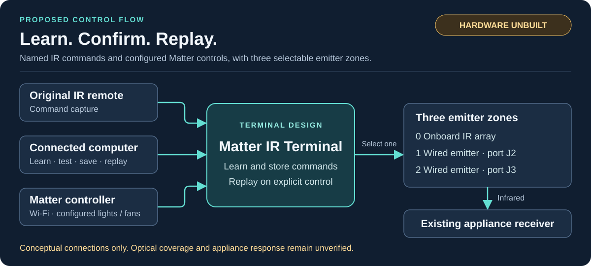

# Matter IR Terminal

**Learn remote commands. Save confirmed actions. Connect compatible IR appliances to Matter.**

Matter IR Terminal is an ESP32-S3 hardware and firmware project for adding local control to existing infrared appliances. It is intended for electronics builders and home-automation developers: commands are learned from an original remote, checked against the appliance, and saved for later use. Configured lights and three-speed fans can appear as native devices in a Matter controller over Wi-Fi.

[**Highlights**](#project-highlights) · [**Compatibility**](#appliance-compatibility) · [**Getting started**](#getting-started) · [**Operation guide**](docs/operation.md) · [**All documentation**](docs/README.md)

> [!IMPORTANT]
> **Prototype design — hardware unbuilt.** Software tests and target compilation are recorded in the [validation report](docs/validation.md). Schematic capture, PCB layout, electrical-rule checks, and physical testing are pending. This is a development project, not a ready-to-install product.

The diagram shows intended control paths, not a physical device. Pin-level connections and electrical limits are in the [hardware design guide](docs/hardware-design.md).

## Project highlights

| Capability | Practical use |
|---|---|
| Learn and name commands | Save confirmed remote actions as readable names such as `light_on` or `fan_low` |
| Matter light and fan controls | Use on/off lights and discrete fan speeds through a Matter controller after profile setup |
| Three selectable emitter zones | Direct each command to the onboard IR array or either of two wired emitters |
| Saved command library | Retain confirmed commands in flash; startup does not automatically replay them |
| Direct console control | Replay named commands or configured aliases from a connected computer, independently of Matter control |

## Appliance compatibility

| Appliance | Available control | Required setup |
|---|---|---|
| IR light | Native Matter on/off | Separate, verified ON and OFF commands; dimming and color are not implemented |
| IR fan | Native Matter off/low/medium/high | Separate, verified commands for each state |
| Gas fireplace | Manually called saved actions | Exact model, verified IR transport, and manufacturer-permitted remote operation; no native Matter fireplace endpoint |
| Portable rolling A/C | Manually called saved presets | Exact model and confirmed complete-state captures; no native Matter thermostat |
| Other compatible IR equipment | Named command replay | Individual waveform and appliance-response checks |

All supplied appliance profiles start disabled. Learning and named replay are independent of profile activation; the project includes no built-in appliance codes. Setup and model-specific constraints are described in the [appliance profile guide](docs/appliance-profiles.md).

An optional [wired Proflame 2 X0A backend](docs/proflame2/software.md) provides software for explicit console control with handset priority retained as a requirement. It is disabled and cannot be activated with the supplied configuration: hardware identity, interface design and bench validation remain incomplete. It adds no native Matter fireplace endpoint.

IR compatibility is not universal. Carrier learning covers 30–60 kHz, and command length, timing, and optical placement also affect compatibility. RF and Bluetooth remote signals are unsupported. Matter displays commanded state without appliance feedback; a missed transmission or use of the original remote can leave displayed and actual state different. Full limits are in the [capture reference](docs/operation.md#capture-boundaries) and [Matter state guidance](docs/appliance-profiles.md#matter-state-and-feedback).

## Getting started

1. **Check suitability.** Identify the appliance and original remote, verify IR transport, and review the [supported profile requirements](docs/appliance-profiles.md).
2. **Prepare the hardware.** Review the [hardware package](hardware/README.md) and complete the applicable [bring-up checks](docs/bring-up.md). The proposed board requires a USB-C source advertising at least 1.5 A at 5 V. Default-current USB ports leave the main supply off; native USB programming also requires a data-capable qualifying source.
3. **Build and flash.** Follow the [build and programming guide](docs/build.md). Linux or Ubuntu WSL is the reference build environment. A connected computer provides the learning console; a Matter controller and Wi-Fi network are needed for Matter control.
4. **Learn, test, and save.** Follow the [first-command workflow](docs/operation.md#capture-and-persistent-save). Replay each capture against the intended appliance and confirm the observed response before saving.
5. **Enable the required controls.** Configure verified [appliance profiles](docs/appliance-profiles.md), rebuild, and follow the [Matter commissioning procedure](docs/operation.md#matter-commissioning). Named replay remains available without enabled profiles.

Saved commands are intended to survive resets and power removal, but physical retention and interrupted-write recovery remain untested. Full-chip erasure, incompatible partition changes, or flash failure can destroy saved commands; see [storage and recovery](docs/operation.md#storage-and-recovery).

The terminal sends optical commands to the appliance's existing receiver. Original safety controls remain in place; the hardware does not connect to gas valves, ignition wiring, compressors, mains circuits, or safety interlocks. Appliance-specific operating and installation restrictions still apply.

## Further documentation

| Task | Guide |
|---|---|
| Learn, save, or replay a command | [Operation and command reference](docs/operation.md) |
| Configure appliance controls | [Profiles, aliases, and compatibility evidence](docs/appliance-profiles.md) |
| Inspect the proposed electronics | [Circuit design, BOM, wiring, GPIO assignments, and sources](hardware/README.md) |
| Navigate code, firmware, tools, and tests | [Programming index and implementation coverage](docs/programming-index.md) |
| Assess project readiness | [Software evidence and outstanding hardware checks](docs/validation.md) |
| Find setup and engineering details | [Complete documentation index](docs/README.md) |

The existing [license file](LICENSE) contains GNU GPL version 3 text. Contribution guidance and outstanding third-party publication checks are in the [development guide](CONTRIBUTING.md#repository-preparation).
