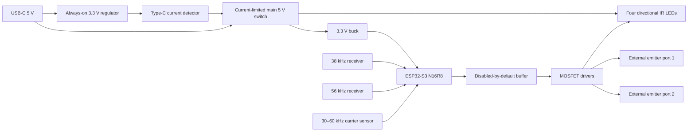

# ESP32-S3 IR terminal hardware design

## Design status and operating envelope

The ESP32-S3-WROOM-1-N16R8 IR terminal uses USB power, Matter over Wi-Fi, BLE commissioning, three independently selectable transmit zones, two demodulated receive channels, and a carrier-aware learning channel. The target indoor ambient range is 0–40 °C. Electrical operation, optical coverage, thermal margins, EMC, and appliance compatibility remain unverified on assembled hardware.

Native appliance mappings initially cover IR lights and fans. Gas fireplace and portable rolling air-conditioner identifiers remain configuration variables until exact appliance and remote models are documented. These categories require no additional baseline hardware. The original appliance receiver, ignition controls, flame supervision, compressor protections, and manual controls remain intact. The node transmits optical commands; it does not connect to gas valves, ignition wiring, compressor wiring, mains circuits, or appliance safety interlocks.

IR learning captures carrier frequency and command timing. Command semantics and appliance state require separate configuration or feedback. RF-only and Bluetooth-only remotes are outside the receiver's capabilities. A captured power-toggle command cannot establish appliance state after a missed transmission or manual operation.

## System arrangement

The diagram summarizes the proposed circuit. Arrows indicate power or signal connections; it does not establish assembled-board operation or replace the pin-to-net schedule.



Circuit connections: [connection schedule](../hardware/connections.csv). Component quantities and population options: [bill of materials](../hardware/bom.csv). GPIO and module-pad assignments: [GPIO map](../hardware/gpio-map.csv). MCU package pad numbers are distinct from GPIO numbers.

## Power input and USB

J1 is a GCT USB4105-GF-A USB 2.0 Type-C receptacle. Join all VBUS pads, join all GND pads, pair A6/B6 for D+, and pair A7/B7 for D−. Route CC1 and CC2 separately to U3. SBU1/SBU2 remain unconnected. Bond shell tabs to the local ground plane. D8–D11 provide connector-adjacent ESD shunts on D+, D−, CC1, and CC2. R12/R13 are 22 Ω series resistors at the MCU. Route the USB pair over uninterrupted ground with approximately 90 Ω differential impedance using the actual PCB stackup.

The circuit requires a USB-C source advertising at least 1.5 A at 5 V. Charger wattage alone does not establish the required Type-C advertisement. USB PD negotiation is not used. Default-current USB hosts and ordinary USB-A-to-C connections leave the main circuit off. Native USB programming requires a data-capable Type-C host or powered hub advertising at least 1.5 A. UART programming requires a qualifying charger and the J4 service header, which has no power pin.

F1 is a 1.5 A hold-current resettable fuse in series with VBUS, before the always-on and main branches. The hold rating applies at 20 °C in still air; the manufacturer's temperature table gives 1.34 A at 40 °C. Local heating and voltage drop require confirmation at the measured load. F1 does not regulate current; U5 limits current into the main circuit. Neither component establishes certified USB or surge compliance. [Littelfuse fuse data](https://www.littelfuse.com/assetdocs/littelfuse-ptc-1206l-datasheet?assetguid=2b6a1515-d4ee-4c83-8bd4-152b4901b8f5)

U2 TLV75533PDBVR supplies `3V3_AON` from fused VBUS with 1 µF input/output capacitors. Its load is limited to the Type-C logic. U3 TUSB320LAIRWBR operates in UFP/sink GPIO mode: PORT grounded, ADDR floating, EN_N grounded, VBUS_DET connected through 887 kΩ to fused VBUS. Its built-in CC pull-downs provide Rd; **additional 5.1 kΩ CC resistors must not be fitted**. OUT1 has a 10 kΩ pull-up to `3V3_AON`; U4 SN74LVC1G14DBVR inverts it to enable U5. OUT1 high disables the main rail; OUT1 low permits 1.5 A or 3 A operation. OUT2, OUT3, and ID are unused. [TI Type-C controller](https://www.ti.com/lit/ds/symlink/tusb320lai.pdf)

U5 TPS2553DBVR switches fused VBUS to `+5V_MAIN`. Its SOT-23 pin assignment is IN1, GND2, EN3, FAULT4, ILIM5, OUT6. R3 = 10 kΩ pulls EN low while U4 is unpowered. R6 = 21.5 kΩ, 1% connects ILIM directly to ground. Table 2 specifies current-limit bounds of 1.106–1.297 A, nominally 1.195 A, including resistor tolerance. The lower bound exceeds the approximately 0.95 A allocation; the upper bound leaves approximately 0.20 A below the minimum accepted 1.5 A source advertisement. Always-on logic also draws from the source. U5 incorporates soft start, current limiting, thermal shutdown, and delayed reverse-voltage protection. A persistent short can cause thermal cycling. [TI power switch](https://www.ti.com/lit/ds/symlink/tps2553.pdf)

R43 = 100 kΩ pulls the open-drain FAULT output to `3V3_AON`; the net reaches a test point only. Its pull-up current is approximately 33 µA, and the pull-up voltage is within the ground-referenced FAULT rating independently of the main rail. R42 = 1 kΩ connects `+5V_MAIN` to ground for discharge, drawing 5 mA at 5 V and dissipating at most 31 mW at 5.5 V with 1% tolerance. No CT capacitor or QOD connection is present. Keep the ILIM trace short and separate from switching nodes.

The main rail has approximately 240 µF nominal direct capacitance: C7 plus C8, C9, and C24. A hypothetical 1 ms, 10–90% ramp at 5 V requires about 0.96 A for those capacitors alone. Buck startup adds load, so current limiting may extend the ramp. The 1 µF-load rise-time specification does not establish startup time for this circuit. Confirm startup at the minimum current limit, minimum input voltage, capacitor tolerances, and full electronics load. Verify fault recovery, F1 temperature, and reverse discharge; reverse-voltage protection has a finite response delay.

U6 AP63203WU-7 converts `+5V_MAIN` to 3.3 V. Connect FB directly to the output after L1, EN to VIN, and C10 = 100 nF between BST and SW. C8 = 10 µF and C9 = 100 nF bypass VIN; C11/C12 = 22 µF each bypass the output. Table 2 of the November 2024 datasheet specifies 3.9 µH for AP63203. L1 is 4.7 µH, within the documented 2.2–10 µH selection range. Effective capacitance under DC bias must be checked. [Diodes converter datasheet](https://www.diodes.com/datasheet/download/AP63200-AP63201-AP63203-AP63205.pdf)

L1 is Coilcraft XAL5030-472MEC: 4.7 µH ±20%, maximum DCR 40 mΩ, specified 6.7 A at 30% inductance reduction and 4.3 A for a 20 °C temperature rise under manufacturer test conditions. These ratings exceed the provisional selection requirements of 3.5 A saturation and 2.7 A RMS; actual PCB temperature and transient response still require measurement. At 5 V input, 3.3 V output, 1.1 MHz, and nominal inductance, calculated inductor ripple is approximately 0.22 A peak-to-peak. [Coilcraft inductor reference](https://www.coilcraft.com/en-us/products/power/shielded-inductors/molded-inductor/xal/xal50xx/xal5030-472/)

The directly connected VBUS capacitance is C1 + C5 = 2 µF nominal. The always-on regulator output adds 1 µF plus two 100 nF bypass capacitors downstream of the LDO. The 220 µF main bulk capacitor is behind U5; it must not be relocated to unswitched VBUS. Verify attach inrush and the complete input-capacitance behavior on the assembled board.

The MCU receives local 10 µF and 100 nF decoupling. EN has a 10 kΩ pull-up and 1 µF to ground; SW1 pulls EN low. GPIO0 has a 10 kΩ pull-up and SW2 to ground for ROM download entry. U1 ground pads 1, 40, and exposed pad 41 connect to the ground plane. No external crystal or SPI memory is required. Keep GPIO35–37 unavailable for application wiring on N16R8. All U1 signals not allocated in the connection schedule remain unconnected; reserved JTAG signals may have unloaded test pads. [Espressif module datasheet](https://www.espressif.com/sites/default/files/documentation/esp32-s3-wroom-1_wroom-1u_datasheet_en.pdf)

### Preliminary current allocation

| Load | Design allocation | Evidence category |
|---|---:|---|
| Main 3.3 V electronics | 0.8 A at 3.3 V | Budget, not measured consumption |
| Buck input at 4.5 V and assumed 85% efficiency | 0.69 A | Calculated allocation |
| Four onboard emitters, nominal carrier-on | 0.22 A | Calculated from 5 V and assumed 1.3 V LED drop |
| Two wired emitters, nominal carrier-on | 0.034 A | Calculated |
| Main-rail discharge resistor | 0.005 A at 5 V | Calculated |
| Combined budget before startup margin | approximately 0.95 A | Preliminary worst concurrent allocation |

Normal firmware should serialize zones. The preliminary power budget includes coincident outputs. The board's 3.3 V load allocation is 0.8 A, including expansion loads; the converter's 2 A component rating exceeds that allocation. F1 derating, supply sag, converter efficiency, and temperature require measurement before acceptance.

## IR reception and learning

U7 TSOP38438 and U8 TSOP38456 produce active-low demodulated envelopes at their nominal 38 and 56 kHz bands. Each uses its own 100 Ω supply resistor, 4.7 µF bulk bypass, and 100 nF ceramic bypass adjacent to pin3. Pin2 is ground. Pin1 reaches GPIO8 or GPIO9 through a separate 100 Ω signal resistor. Outputs are independent and must not be wired together. Their AGC behavior constrains the pulse patterns accepted even at the nominal carrier frequency. [Vishay demodulating receivers](https://www.vishay.com/docs/82491/tsop382.pdf)

U9 TSMP98000 provides the carrier-aware channel on GPIO10:

```text
3V3_MAIN ---- R16 100R ----+---- U9 pin3 VS
                         +---- C22 4.7uF ---- GND
                         +---- C23 100nF ---- GND
                         +---- R20 4.7k -----+
                                            |
U9 pin1 CARRIER_OUT -------------------------+-- R19 100R -- GPIO10
U9 pin2 GND ----------------------------------------------- GND
```

The external 4.7 kΩ pull-up supports fast output edges; it returns to the locally filtered receiver supply. The TSMP98000 specified learning band is 30–60 kHz. Its output conveys individual carrier cycles; it is not a demodulated mark/space stream. Firmware estimates carrier from pulse intervals and separately recovers mark/space envelopes. Buffer overflow and malformed timing cause capture rejection. A 15 ms idle interval ends reception, so an accepted timing record can still omit later frames of a multi-frame command. Protocol completeness and appliance behavior require comparison with the original remote before a capture is confirmed. [Vishay learning sensor](https://www.vishay.com/docs/82908/tsmp98000.pdf)

Provide a front-facing learning aperture with access for a remote at approximately 0.1–1 m, adjusting distance experimentally. Start around 0.3 m and inspect the signal for clipping or missing cycles. Keep receiver supply traces and ground returns away from the buck switch node, antenna, and LED current loops. Use an opaque divider between receivers and transmit LEDs. Ignore or explicitly classify self-transmitted frames in software; electrical filtering does not remove optical feedback.

J5 offers GPIO7 for an optional 36 kHz receiver or a future comparator output. Any optional module must supply a 0–3.3 V signal with defined idle level and its own local bypassing. No photodiode amplifier or 455 kHz learning circuit has been designed or validated in this baseline. Such an extension requires bandwidth, optical, noise, and capture-rate analysis before implementation.

## Transmitter control and LED drivers

GPIO4, GPIO5, and GPIO6 feed three channels of U10 SN74LVC125APWR, powered at 3.3 V. GPIO18 drives their common active-low output-enable net `TX_OE_N`; R11 = 10 kΩ pulls this net high. Each input also has a 10 kΩ pull-down. Unused U10 input4A is grounded, output4Y is open, and output-enable4 is tied high. Each used output passes through 220 Ω to a MOSFET gate, with 10 kΩ gate-to-source pull-down. These connections disable emitters during reset and prevent floating buffer inputs. [TI buffer](https://www.ti.com/lit/ds/symlink/sn74lvc125a.pdf)

Q1–Q3 are AO3400A N-channel MOSFETs: pin1 gate, pin2 source to GND, pin3 drain to the relevant cathode return. Their on-resistance is specified at 2.5 V gate drive, suitable for the 3.3 V logic domain; gate threshold alone is not a selection criterion. Verify switching transitions with the assembled board. [AOS device reference](https://www.aosmd.com/products/mosfets/low-voltage-mosfets-12v-30v/ao3400a)

```text
GPIO4 --> U10 buffer1 --> R21 220R --> Q1 gate
                         Q1 gate --> R24 10k --> GND
                         Q1 source -----------> GND

+5V_MAIN -- R34 68R/1W -- D1 TSAL6200 anode -> cathode --+
+5V_MAIN -- R35 68R/1W -- D2 TSAL6200 anode -> cathode --+
+5V_MAIN -- R36 68R/1W -- D3 TSAL6200 anode -> cathode --+-- Q1 drain
+5V_MAIN -- R37 68R/1W -- D4 TSAL6200 anode -> cathode --+
```

Each LED has a separate resistor to control branch current. At nominal 5 V and an assumed 1.3 V LED drop, each branch carries `(5−1.3)/68 = 54.4 mA` during carrier-on time. At one-third carrier duty this is about 18 mA average during a mark. Current limiting remains effective during a continuous HIGH output. TSAL6200 is a 940 nm emitter with ±17° half-intensity angle; orient the four devices toward distinct required viewing directions and validate optical coverage through the final enclosure. [Vishay emitter](https://www.vishay.com/docs/81010/tsal6200.pdf)

With a conservative 5.5 V rail and a minimum 67.32 Ω resistor, even a shorted LED produces at most 81.7 mA in that branch; resistor dissipation is 0.45 W. A 1 W part provides useful margin at 40 °C. An intact LED sees lower current and resistor dissipation. This calculation covers a static branch fault, not every board fault or enclosure thermal condition. Initial firmware settings should use one-third carrier duty, explicit maximum command duration, and no endless repeat mode.

Transmit sequencing is: hold GPIO18 high; configure all TX outputs low; initialize waveform peripherals; enable GPIO18 low only for a bounded authorized transmission; wait for completion; return outputs low; set GPIO18 high. This buffer is not a hardware watchdog. If firmware holds a valid waveform or HIGH output indefinitely while enabled, the LEDs remain driven; passive current limiting only bounds current.

## External emitter ports

J2 and J3 use keyed JST XH 2.50 mm B2B-XH-A headers with XHP-2 harness housings. Port pins are **not general-purpose power outputs**:

| Pin | Net | Function |
|---|---|---|
| 1 | EXTn_ANODE | +5V_MAIN through a dedicated 220 Ω, 0.5 W resistor |
| 2 | EXTn_RETURN | Q2 or Q3 switched drain; never hard-ground this conductor |

```text
+5V_MAIN -- R38/R39 220R -- J2/J3 pin1 -- LED anode
                                            LED cathode -- J2/J3 pin2 -- Q2/Q3 drain
                                                |                         |
                             antiparallel diode |                  Q2/Q3 source -> GND
                      cathode at LED anode -----+
                      anode at LED cathode
```

Each harness carries one TSAL6200 and one 1N4148 antiparallel to it: diode cathode at LED anode, diode anode at LED cathode. This limits reverse LED bias if a harness is assembled incorrectly. Start with twisted 26 AWG conductors no longer than 2 m and validate the final length, temperature, optical mounting, and connector retention. Opaque emitter covers reduce cross-control of nearby appliances.

Nominal current is `(5−1.3)/220 = 16.8 mA`. A shorted port at 5.5 V with a 217.8 Ω minimum resistor draws 25.3 mA and dissipates 0.139 W, below the selected 0.5 W rating. Unplugged ports draw no LED current. Do not parallel multiple emitters on one port without a new current-sharing design.

D12/D13 SS14 clamp each drain toward `+5V_MAIN` with anode at drain and cathode at the supply. D14–D17 SMAJ6.0A connect each exposed port conductor to ground, cathode on conductor and anode at ground. These are proposed transient protections; layout, parasitic inductance, rail injection, and system-level ESD response require measurement. No external power source may be connected to an emitter port. [TVS family data](https://www.littelfuse.com/~/media/electronics/datasheets/tvs_diodes/littelfuse_tvs_diode_smaj_datasheet.pdf.pdf)

An optional external 3.5 mm mono adapter may connect tip to pin1 and sleeve to pin2 only after continuity verification. The sleeve is a switched return, not chassis ground. An audio cable or commercially powered IR blaster is not assumed electrically compatible. Hot-plug shorts are current limited by the port resistor; connector polarity must still be verified.

## Service and expansion

J4 is a 1×4, 2.54 mm UART header: pin1 GND, pin2 board TX/GPIO43, pin3 board RX/GPIO44, pin4 EN. Use a 3.3 V USB-UART adapter; connect adapter RX to board TX and adapter TX to board RX. R32/R33 = 1 kΩ reduce accidental contention current. No adapter power pin is present. Avoid driving UART signals into an unpowered board. Hold BOOT while asserting RESET to enter the ROM loader.

SW3 is the commissioning button on GPIO14, with 10 kΩ pull-up and 100 nF to ground. D7 is an active-high status LED driven from GPIO21 through 1 kΩ, cathode to ground. J5 is a keyed 1×6 expansion header: 1 GND, 2 3V3_MAIN, 3 GPIO7, 4 GPIO11/SDA, 5 GPIO12/SCL, 6 GPIO13/reserved. Optional R28/R29 = 4.7 kΩ I2C pull-ups remain unpopulated until a module is selected. Expansion signals are 3.3 V only, short internal cables only, with a provisional 50 mA load limit included within the main power budget.

Optional R30/R31 = 100 kΩ and C25 = 10 nF provide GPIO1 monitoring of `+5V_MAIN/2`. The divider must use the switched rail, not always-on VBUS, to avoid back-powering an unpowered ESP32. ADC calibration and divider tolerance limit voltage accuracy; no source-current capability is inferred from this measurement.

## PCB and enclosure requirements

- Use a four-layer board with a continuous ground plane and short local decoupling loops. Keep the buck's VIN-capacitor, switch, inductor, and ground loop compact; route FB away from SW.
- Place the ESP32 module antenna at a board edge with the manufacturer-specified copper and enclosure keepout. Keep metal fasteners, emitter wires, and ground pours outside that region.
- Route LED return currents to the power entry/bulk-capacitor region through low-impedance paths; do not force these currents through receiver ground traces. Preserve a continuous reference plane rather than splitting signal return paths.
- Place ESD components at connectors with short ground vias. The proposed 1 mm ESD packages and 1.6 mm Type-C controller require controlled PCB assembly, not solderless breadboard construction.
- Provide test points for fused VBUS, 3V3_AON, OUT1, MAIN_ON, MAIN_FAULT_N, +5V_MAIN, 3V3_MAIN, TX_OE_N, all three TX waveforms, three receiver outputs, and GND.
- Mark every connector pin1 and LED/diode polarity on silkscreen. Provide strain relief for external emitters. Verify IR transmission of the enclosure window rather than assuming visibly dark plastic is IR-transparent.
- Place the node and emitter cables outside the appliance's prohibited heat zones and follow the selected appliance's installation instructions. Location qualification remains pending while fireplace and AC models are unspecified.

Fabrication release requires schematic capture, footprint and pin review, ERC, placement/routing, DRC, and assembly review. Electrical and optical acceptance requires the staged checks in the [hardware bring-up procedure](bring-up.md).
