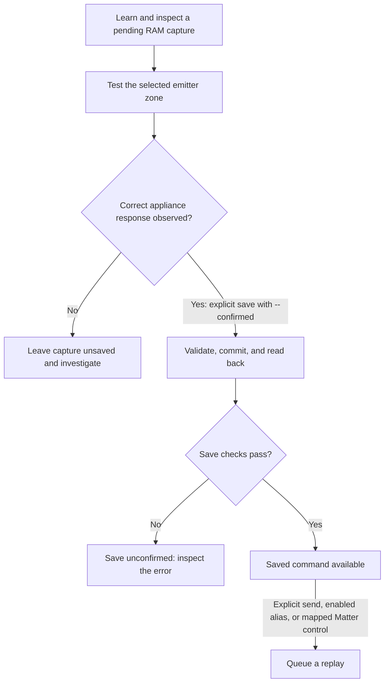

# IR learning and operation

This guide covers a programmed terminal's local console, saved commands, and Matter commissioning. Hardware preparation and firmware installation are described in the [build and programming guide](build.md); appliance mappings are described in the [profile guide](appliance-profiles.md).

## Console connection

The default console uses the ESP32-S3 native USB Serial/JTAG interface. Connect through a data-capable USB-C source advertising at least 1.5 A. Select the enumerated port in `idf.py monitor` or a serial terminal. The UART console can be selected in `menuconfig` for the service header; both are not active consoles simultaneously.

Use one console client at a time. Serial commands originate from a physically connected operator. No unauthenticated network command service is included.

The console accepts up to 255 printable ASCII characters per line, terminated by Enter. Backspace and Delete remove the preceding character. An oversized line or any other control character rejects the entire line; no valid prefix is executed. Ctrl+C followed by Enter cancels the current line. An incomplete line at end-of-input is discarded. ANSI terminal probing, arrow-key history, and tab completion are disabled so interactive terminals and the serial helper use the same input behavior.

## Capture and persistent save

1. Aim the original remote at the learning aperture, initially about 0.3 m away.
2. Enter `learn`. The receiver waits up to ten seconds. Press the intended button once.
3. Enter `show` to inspect the measured carrier and mark/space durations.
4. Enter `test 0`, `test 1`, or `test 2` for the intended emitter zone.
5. Observe the appliance. A console transmission message does not establish correct operation.
6. After correct operation is confirmed, enter `save NAME --confirmed`.
7. Enter `codes` and `show NAME` to inspect the persisted command.
8. Reboot or remove power after successful save; repeat `show NAME` and an explicit `send NAME ZONE` during bench qualification.

Names use one to fifteen lowercase letters, digits, or underscores. A new capture replaces only the pending RAM capture. Previously saved names remain unchanged. To deliberately replace a saved command, use `save NAME --confirmed --overwrite`.

Example console sequence, with the appliance response checked before the save step:

```text
ir> learn
ir> show
ir> test 0
ir> save light_on --confirmed
ir> send light_on 0
```

`test` transmits the pending capture. `--confirmed` records the operator's assertion that the appliance responded correctly; firmware cannot verify that response. The sequence below describes the manual workflow and software save checks, not completed hardware qualification.



## Commands

| Command | Behavior |
|---|---|
| `help` | Show command syntax |
| `learn [carrier\|38\|56]` | Capture one frame into RAM; default measures carrier through TSMP98000 |
| `show` | Print the pending capture as JSON |
| `test ZONE` | Transmit the pending capture once without saving |
| `save NAME --confirmed [--overwrite]` | Commit an explicitly confirmed capture |
| `codes` | List persisted command names |
| `show NAME` | Load, validate, and print a stored waveform |
| `send NAME ZONE [REPEATS [GAP_MS]]` | Queue a saved waveform; defaults are one transmission and 40 ms between repeats |
| `delete NAME --confirmed` | Delete one saved command |
| `profiles` | List the compiled profile enable state and zone |
| `call DEVICE ACTION` | Resolve an enabled profile alias to a saved command |
| `x0a status` | Read cached X0A diagnostics without UART traffic; the backend is disabled by default |
| `x0a refresh` / `x0a set FIELD VALUE` | Explicit qualified wired operations; rejected while hardware qualification is incomplete |
| `commission` | Open a 300-second Matter commissioning window and print basic-window pairing information; an existing window is retained |
| `matter-reset --confirmed` | Reset Matter fabric configuration and restart through the SDK |

Zone 0 selects all four onboard LEDs together. Zones 1 and 2 select external emitter ports J2 and J3. Outputs are serialized; no simultaneous-zone command is exposed. Repeats are limited to 1–5 and the gap to 20–500 ms. Repetition sends the same full frame; it does not generate protocol-specific repeat frames or toggle bits.

## Profile aliases and scripting

The [wired X0A reference](proflame2/software.md#console-interface) defines the separate command grammar, local operation results and recovery behavior. It is not an IR alias backend. X0A activation is blocked until hardware and bench qualification; `x0a status` remains available without transmitting.

Enabled profile aliases provide descriptive operations:

```text
call room_light on
call room_fan medium
call fireplace flame_up
call portable_ac cool_preset
```

Model-independent commands remain callable directly with `send NAME ZONE`. A disabled profile blocks its `call` aliases, but does not restrict direct bench operation of independently saved commands.

An optional serial client supports scripts:

```powershell
python -m pip install -r tools/requirements.txt
python tools/ir_terminal.py --port COM7 send light_on 0
```

`tools.ir_terminal.send_saved(port, name, zone)` sends one explicit command and returns collected console output. The zone must be an integer from 0 to 2. The client accepts one printable ASCII command of at most 255 characters and a timeout of 1–120 seconds. Incomplete or failed serial writes are reported without retry. Collected output, queue messages, and transmission completion are distinct from appliance response.

## Matter commissioning

Development builds use the SDK's example commissioning and attestation settings. They are unsuitable for production identities or certification claims. Use the build's reported onboarding information with a Matter controller, or the selected SDK's test setup parameters during development.

Hold the commissioning button for approximately one second or enter `commission` to open a 300-second window. An existing window keeps its original deadline. The console prints the configured manual pairing code and QR payload for a basic window. An enhanced window opened by another controller retains that controller's code.

Initial pairing uses BLE to provision Wi-Fi. The selected SDK releases BLE after commissioning; subsequent local commissioning windows use network discovery when Wi-Fi credentials are present. The controller must reach the same network. The default configuration creates the bridge root and aggregator without enabled appliance endpoints. Enable and validate [light/fan profiles](appliance-profiles.md) before expecting appliance controls in a controller.

After changing endpoint topology, remove the previous bridge from the controller, reset Matter configuration explicitly, and recommission. Saved IR commands remain in their separate partition. Ecosystem behavior requires testing with the actual controller and appliances. Matter attributes describe commanded state; the [state and feedback limitations](appliance-profiles.md#matter-state-and-feedback) apply after commissioning.

## Storage and recovery

The storage path validates the waveform, writes a versioned record to the dedicated `ir_store` partition, commits NVS, then reads and compares the stored record. Success requires every step, including CRC validation and an exact waveform comparison. A failed save must not be treated as confirmation of persistence. Power interruption during a write can leave the new value unavailable; commands already committed before the interruption are intended to remain recoverable. NVS provides power-interruption recovery, but assembled-board brownout and interruption testing remains necessary. [ESP-IDF NVS behavior](https://docs.espressif.com/projects/esp-idf/en/v5.4.1/esp32s3/api-reference/storage/nvs_flash.html)

Committed commands are stored in nonvolatile flash for recovery after resets and power removal. Physical retention and power-interruption recovery remain untested; pending RAM-only captures are lost at reset. No startup replay, automatic failed-send retry, or automatic storage erasure is implemented.

`matter-reset --confirmed` resets Matter configuration through the SDK and leaves `ir_store` separate. Ordinary application flashing preserves learned commands when partition offsets and sizes remain unchanged. `idf.py erase-flash` erases the entire flash device, including learned commands. Incompatible partition changes or flash failure can also destroy saved data. Preserve the partition layout across firmware updates and follow the [flashing and recovery procedure](build.md#flashing-and-recovery).

Reset is rejected while an IR or X0A operation is busy. Before scheduling an idle reset, X0A is quiesced atomically and remains disabled even if reset scheduling fails. No OFF command or state-restoration command is sent.

`show NAME` exports readable waveform data for records. A waveform import command is not implemented; export alone is not an automated restore procedure. Physical persistence acceptance follows the [storage and interruption tests](bring-up.md#7-persistent-storage-and-interruption-tests).

## Capture boundaries

- Carrier learning covers 30–60 kHz. Envelope inputs use nominal 38 or 56 kHz and cannot measure an unknown carrier.
- One capture ends after 15 ms without an edge. Protocols containing longer internal spaces, multi-frame sequences, rolling state, or special hold/repeat behavior require separate analysis. A single capture does not copy an arbitrarily long button hold.
- The DMA capture buffer holds 16,384 symbols; a full buffer is rejected. At 60 kHz, continuous carrier reaches this limit in about 273 ms. Spaces reduce the cycle count, but total validated replay duration remains limited to 500 ms.
- Persisted frames start and end with a mark, contain at most 4,095 alternating durations, and use microsecond envelope timing. The learning sensor does not establish the original optical duty cycle; replay defaults to 33 percent.
- Normal receiving hardware is available, but continuous remote observation and automatic appliance-state reconciliation are not implemented. Reception occurs during explicit learning.
- Rejected captures remain unsaved. RF and Bluetooth remote-control signals are unsupported.
