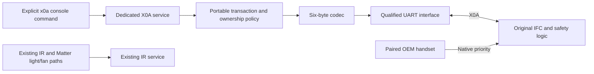

# Wired X0A Control Implementation Plan

**Status:** software implementation added **2026-10-28**, United States scope; production activation remains blocked and G0–G5 remain pending. The [software reference](software.md) describes current behavior and [qualification record](hardware-qualification.md) records missing physical evidence. Handset override remains a requirement. No hardware or appliance operation was performed.

**Goal:** Add an optional wired Proflame 2 control service that reproduces qualified ordinary commands, yields to the paired handset, and reports uncertain outcomes accurately.

**Architecture:** Retain the current ESP32-S3, IR transport, command storage, and Matter light/fan behavior. Add a separate portable X0A protocol/controller component, a dedicated UART adapter, and explicit console commands. This is a proposed extension of the current implementation, not an assertion that its hardware allocation or future Matter fireplace representation is already approved.

**Tech stack:** C++17, ESP-IDF `v5.4.1`, FreeRTOS, the existing ESP-Matter commit `4cedd4ad40821933d6cc237e80ab6604f2953fb0`, and Python standard-library configuration tooling. Preserve the [pinned SDK baseline](../sdk-reference.md); no dependency upgrade is required by this plan.

**Spec and evidence:** [Wired protocol](wired-protocol.md), [integration policy](integration.md#candidate-wired-controller), [passive/isolated validation plan](validation-plan.md), and [hardware identification](hardware-variants.md). UART details are independent reverse-engineering evidence, not a public SIT-supported API. The implementation remains gated on the actual appliance and IFC.

**Execution status:** The task lists below retain the original acceptance requirements; their unchecked boxes do not independently report implementation status. The [software reference](software.md) and [verification report](../validation.md) distinguish completed software from pending physical validation. No repository initialization, commit, push, flashing, transmission, or appliance operation was performed.

The implementation adds `RefreshComplete` and `RecoveryRequired` outcomes, a measured `inter_byte_ms` timing input, and a portable byte-framing `Session`. Atomic `prepare_reset()` supplements the service API to prevent a check/quiesce race. No qualified enabled target build is available: the reviewed-profile registry is empty, and the supplied production build remains disabled. These refinements preserve the architecture and hardware gates below.

## Global constraints

- Preserve the paired handset and its native priority. No unpairing, selector manipulation, RF interception, or repeated ownership requests to defeat denial.
- Begin physical investigation with passive capture or an isolated receiver fixture with fuel and ignition outputs safely disconnected under the applicable manufacturer procedure. No safeguard emulation or bypass is permitted.
- Support only documented ordinary registers `0x16`, `0x17`, and `0x18`; expose typed controls rather than a general register-write console.
- Startup, reconnect, commissioning, reset, and configuration loading must not claim ownership, restore a remembered state, or send appliance commands.
- No automatic retry or rollback of state writes. A write with a missing response may already have taken effect.
- Preserve the existing IR profiles, `IRW1` records, `ir_store` partition, three emitter zones, and native Matter light/fan endpoints.
- Keep requested state, last register readback, and actual combustion status distinct. No flame-presence or guaranteed-OFF claim follows from UART readback.
- Leave X0A disabled by default. No supplied hardware profile can enable control before its qualification record is complete.
- Retain normal IFC lockouts, flame supervision, thermal/air-pressure protections, and ignition sequencing. A bench lockout is an outcome to record, not a condition to bypass.

## Review focus

These failure classes determine the task tests and bench gates:

1. **Handset activity between ownership check and write:** the IFC must preserve handset precedence; software cannot eliminate this race using polling alone. Covered by Task 2 and gate G3.
2. **Late, duplicated, or corrupt responses:** no transaction identifier exists in the observed format. Old bytes must not authorize a new write. Covered by Tasks 1-2 and gate G2.
3. **Reset, brownout, USB reconnect, or split power supplies:** no boot/console bytes or backfeed may reach the IFC. Covered by Tasks 3-4 and gates G1/G4.
4. **Unknown mode, unsupported output, or stale state:** reject the request instead of replacing an entire state byte from a guessed baseline. Covered by Tasks 1-3.
5. **Lost response after a state write:** report `indeterminate`, discard pending work, and require explicit read-only recovery; do not retry or report success/OFF. Covered by Tasks 2 and 5 and gate G4.

## Current project boundaries

| Current owner | Inspected behavior | Planning implication |
|---|---|---|
| [app_main.cpp](../../firmware/main/app_main.cpp) | Initializes IR, Matter, and console | Add optional service initialization without changing the firmware target or replaying state |
| [board_config.hpp](../../firmware/main/board_config.hpp) and [GPIO map](../../hardware/gpio-map.csv) | Own IR, console, USB, and expansion assignments | Allocate a separate UART and qualified pins; existing reservations remain binding |
| [ir_core.hpp](../../firmware/components/ir_core/include/ir_core.hpp) and [ir_service.hpp](../../firmware/main/ir_service.hpp) | Waveforms, stored IR codes, serialized IR jobs | X0A messages must not be represented as learned IR waveforms or sent through an emitter zone |
| [profile_config.py](../../tools/profile_config.py) | Schema 1 requires verified IR transport and command names | Keep schema 1 intact; introduce a focused X0A configuration owner |
| [terminal.cpp](../../firmware/main/terminal.cpp) | `send` and `call` route to IR; USB console has UART fallback | Add an explicit `x0a` command family; preserve existing command meanings |
| [matter_app.cpp](../../firmware/main/matter_app.cpp) | Native endpoints only for light/fan; state follows queued IR commands | Do not copy this optimistic state model into fireplace controls |
| [ir_terminal.py](../../tools/ir_terminal.py) | Sends one explicit console command without retry | Reuse generic invocation; do not turn it into a direct IFC serial driver |
| [test-host.sh](../../tools/test-host.sh) | Python tests and C++17 host binaries; console tested in USB/UART modes | Extend the existing runner rather than introducing a new test framework |

The [hardware package](../../hardware/README.md) remains unbuilt. No exact target fireplace, handset, IFC, or accessory identification has been supplied. Git metadata was absent during initial planning; the implementation performs no project Git initialization, commit or push. Concurrent metadata changes are recorded separately in the [verification report](../validation.md#wired-x0a-software-verification-2026-10-28).

## Hardware prerequisites

Complete a qualification record before selecting pins, ordering an interface, or enabling target control. Photographs must identify the viewing direction; wire color and physical connector fit are insufficient evidence.

| Required detail | Evidence needed | Decision it controls |
|---|---|---|
| Appliance identity and permitted integration | Manufacturer, model, serial range, installation/service-manual revision, approved remote/accessory options | Whether X0A attachment and the proposed service arrangement are permitted |
| IFC identity | Complete SIT/OEM part number, PCB/firmware revision if available, label/schematic photographs, Basic/Standard/Complete, ATMO/FAN and Connect indications | Applicability of the reported protocol and safety/power behavior; `.325` and `.665` examples are not interchangeable defaults |
| Handset identity | Full part number, FCC ID, Connect indication, enabled controls and current association | Exact priority and control-mode behavior; handset remains paired |
| Existing X0A connection | Connected dongle/eFIRE module, harness part number, serial-master inventory | Passive tap versus substitution; never connect two transmitting masters in parallel |
| Connector assignment | Keying, mating parts, orientation, identified GND/TX/RX/3V3, continuity under the approved unpowered procedure | Final harness drawing; source-reported order is `3V3 / TX / RX / GND` only in its referenced view |
| Electrical signaling | Idle voltage/polarity, high/low levels, timing, input tolerance and ground/reference relationship | Appropriate input protection, UART interface and instrument connection |
| Isolation | Manufacturer electrical information and qualified assessment of mains/ignition separation and instrument grounding | Whether galvanic isolation and an isolated supply are required; no direct ground tie is assumed safe |
| Power behavior | Available accessory current, backup-battery operation, power sequencing and unpowered-pin leakage | Interface supply and backfeed prevention; the X0A 3V3 pin is not presumed capable of powering an ESP32 |
| Controller board | Actual custom board or development-board model/revision, occupied GPIOs/UARTs, expansion loads | Pin/peripheral allocation; a development board requires its own audit |
| Installed functions | Flame, fan, light, AUX and split-flow presence; thermostat and pilot settings | Per-board capability allowlist and writable-field restrictions |
| Mechanical environment | Cable length/routing, ignition/mains separation, enclosure temperature and service access | Connector retention, insulation, protection and installation suitability |

The candidate interface is **3.3 V logic, 9600 baud, 8N1**, based on [S14](sources.md#s14) and [S15](sources.md#s15). Treat those values as hypotheses until G1/G2 pass. An RS-232 adapter or a 5 V UART is not equivalent.

### Project pin and power decisions

- **Do not use J4 as a ready-made X0A connector.** It carries GND, GPIO43/TX, GPIO44/RX and EN for programming/console use. Boot logs or console traffic must never reach the IFC.
- **Do not reuse J2/J3.** They are powered IR emitter connections with switched returns, not UART ports.
- **Do not silently repurpose J5.** GPIO7 is reserved for an additional receiver; GPIO11/12 are optional feedback I2C; GPIO13 is reserved. Its 3.3 V expansion allocation is provisionally 50 mA and its existing wiring is intended for short internal connections.
- Propose a dedicated keyed interface connection and an otherwise available hardware UART, with final GPIOs assigned only after the board audit. Do not consume USB GPIO19/20, strapping pins, N16R8 PSRAM pins, IR GPIOs, or reserved expansion roles without an explicit hardware decision.
- Require a hardware-defined transmit-disabled condition during reset/unpowered states. Whether that uses a buffer, isolator, or another circuit is an electrical-design outcome. The existing IR transmit inhibit does not gate X0A.
- Power the terminal through its established qualified supply. Do not connect the terminal's 3.3 V/5 V rail to the IFC accessory supply. Any IFC-side isolation-circuit supply needs its own current and power-sequencing qualification.

These constraints follow the current [hardware design](../hardware-design.md#service-and-expansion), [connection schedule](../../hardware/connections.csv), and [wired electrical limits](wired-protocol.md#electrical-and-transport-layer). If the existing board cannot meet them without reassignment, document the hardware revision needed before proceeding.

## Bench gates and sequence

No bench work was performed for this plan. Gates are ordered dependencies, not software test substitutes. An offline codec/state-machine implementation can be developed later against recorded fixtures without hardware, but **G0-G3 must pass before a target control implementation is enabled on an IFC**. G4/G5 are required before any installed-use claim. No live-fuel test is prescribed here.

| Gate | Proposed work | Required record and pass condition |
|---|---|---|
| G0 — Identity and fixture | Complete the identity table; obtain the exact OEM service/isolation procedure and authorized integration basis | An identified IFC/handset/appliance combination and a permitted passive/isolated fixture. If no suitable procedure exists, remain at offline/passive research |
| G1 — Electrical qualification | Inspect connector orientation and reference/isolation; measure signals and supply sequencing with suitable high-impedance/isolated instruments | Reviewed harness/interface design, measured levels and current budget, no backfeed or uncontrolled TX during either-side power loss. No grounded computer/instrument is connected before reference/isolation is established |
| G2 — Passive protocol | Observe both directions with an existing approved accessory as the sole master; retain raw timestamps and bytes | Confirm actual UART settings, six-byte framing, XOR, request/response types, allowed registers, response latency and gaps. Silence without an accessory is inconclusive because unsolicited output is not established |
| G3 — Isolated arbitration and ordinary controls | After G0-G2, use a reviewed bench instrument as the sole master on the isolated fixture; exercise only captured ordinary requests | Confirm grant/denial, state-read validity, capability masks, and handset precedence before ownership request, during baseline acquisition, immediately around the state write, and after it. An observed priority violation blocks this integration; no unpairing workaround |
| G4 — Integrated failure behavior | With the new adapter/service on the isolated fixture, test unplug, restart, brownout, low supply under an approved procedure, malformed/late replies, and host disconnect | No unsolicited state writes, retries, restart replay or console leakage. Report uncertain writes accurately. Handset remains usable under the qualified conditions. If the fixture locks out, record it and stop the affected test |
| G5 — Coexistence and installation review | Check IR capture/TX, Wi-Fi/Matter traffic, commissioning, reset, thermal/mechanical suitability, and OEM installation requirements | Existing project behavior remains intact; timing bounds hold under load; all installation/operational qualifications are separately documented. Protocol success alone is not appliance approval |

G3 can use reviewed, bounded bench instrumentation; it does not require installing a production controller. If no approved accessory is available for passive traffic, G2 remains incomplete until an OEM-supported capture/fixture route is available. Unknown registers or brute-force payloads are not a substitute.

### Measurements that must become configuration

Record request-to-response and inter-byte timing distributions, instrument resolution, tests under concurrent load, and a justified late-response/quiet-time bound. Freeze `response_timeout_ms`, `inter_request_ms`, `resync_quiet_ms`, and `snapshot_max_age_ms` in the qualified profile. The community component's 50 ms spacing and 250 ms timeout are comparison points, not approved defaults. No write-capable supplied profile has guessed values.

The observed wire protocol has no sequence number. A six-byte reply can match an earlier identical request. Recovery therefore requires a measured bounded quiet interval, receive-buffer/parser reset, and a new read-only exchange. If late replies cannot be bounded sufficiently to establish correspondence, command control remains unqualified. Tests cannot manufacture a wire-level transaction identifier.

Record the exact IFC behavior after communication loss and power restoration. A controller disconnect must not be represented as a guaranteed fireplace shutdown: the IFC may retain a request, and the manufacturer describes restart behavior on supply restoration. [S02, p. 13](sources.md#s02)

## Proposed implementation contract

### Control and state semantics

The first increment provides manual console control of power and absolute flame level. Fan, light, AUX and split flow are enabled individually only where G3 qualifies them. Pilot-mode changes, thermostat/SMART control, setpoints, lockout resets and unknown registers are excluded from this increment. Existing pilot and thermostat bits are preserved; any mode combination not qualified for the requested operation causes rejection. No guessed enum mapping is used.

Each deliberate change is one bounded operation:

1. Reject when disabled, busy, awaiting recovery, or outside the qualified capability/value set. Keep no pending actuation queue.
2. Issue at most one ownership SET request for that operation. A denial ends it; background polling never repeats an ownership SET.
3. Confirm ownership with GET `16`, then read `17` and `18` for a fresh baseline. Reject malformed payloads, unsupported states, or expired baseline data.
4. Recheck ownership immediately before writing. Patch only the requested field in one state register, preserving every unrelated field. If it already matches, complete as `no_change` without a state write.
5. Validate the state-write response and perform ownership-checked readback. Return `readback_matched` only for a matching, valid exchange; this is register evidence, not combustion evidence.
6. On denial or observed ownership loss, stop further state writes and invalidate the baseline. After a state write has been issued, any missing/mismatched response, ownership loss, or readback failure produces `indeterminate`; no retry or rollback follows.

An ordinary GET `16` value of zero means UART ownership is not established; it does not by itself prove that a person is actively using the handset. Report `not_granted` or the actual denial evidence rather than inventing a live RF observation.

The IFC must enforce handset precedence in the remaining check/write race. Software only learns of remote intervention through later serial evidence; no instantaneous notification is assumed. Even a recent readback is a timestamped observation, not a guaranteed live state. Successful ownership recovery never resurrects a previous request: a fresh deliberate command and baseline are required.

`x0a status` reads cached diagnostic state without transmitting. `x0a refresh` requests a bounded read-only exchange, including recovery after an established quiet interval when needed. It must never contain an ownership SET. There is no background UART traffic in the first increment. A snapshot expires to unknown using its configured age; there is no persistent desired state or automatic resume.

### Boundaries and interfaces



The software path in the diagram is implemented behind disabled qualification gates; the physical interface is proposed. No additional MCU, cloud service, or firmware target is selected. Future Matter fireplace exposure requires a separate endpoint decision.

Use explicit byte arrays rather than packed structures or compiler-dependent bitfields. Proposed portable contracts are:

```cpp
namespace proflame2 {
using Frame = std::array<std::uint8_t, 6>;
enum class Register : std::uint8_t { Control = 0x16, State1 = 0x17, State2 = 0x18 };
enum class Field { Power, Flame, Fan, Light, Aux, SplitFlow };
struct Change { Field field; std::uint8_t value; };
struct Message { std::uint8_t type; std::array<std::uint8_t, 3> payload; Register reg; };
enum class Ownership { Unknown, NotGranted, Granted };
enum class Outcome {
    None, ReadbackMatched, NoChange, Disabled, Busy, InvalidRequest,
    Unsupported, ExternalControl, Timeout, ProtocolError, Indeterminate
};
struct Timings {
    std::uint32_t response_timeout_ms, inter_request_ms;
    std::uint32_t resync_quiet_ms, snapshot_max_age_ms;
};
struct Snapshot {
    Ownership ownership;
    std::uint8_t state1, state2;
    std::uint64_t observed_ms;
    bool readback_valid, resync_required;
    Outcome last_outcome;
};
std::uint8_t checksum(const Frame &frame); // XOR of offsets 0..4.
Frame encode(const Message &message);
bool decode(const Frame &frame, Message &message);
}
```

Task 2 defines `Controller` around these contracts: `begin_refresh(now_ms)`, `begin_change(Change, now_ms)`, `next_request(Frame &, now_ms)`, `on_reply(const Frame &, now_ms)`, `on_transport_error(now_ms)`, `tick(now_ms)`, `snapshot(now_ms)` and `busy()`. Time arguments use `std::uint64_t`; begin methods return `Outcome` (`None` means the operation was accepted), `next_request` returns `bool`, event methods return `void`, `snapshot` returns `Snapshot`, and `busy` returns `bool`. Construct it as `Controller(const Timings &, const std::array<bool, 6> &capabilities)`, copying the validated timing and allowlist values. Allowlist positions follow the six `Field` enumerators; callers cannot supply arbitrary writable register masks.

The ESP-IDF service owns its single controller instance, UART RX assembly and TX gating. Its public interface in `proflame2_service.hpp` is `esp_err_t init()`, `esp_err_t refresh()`, `esp_err_t request(proflame2::Change)`, `proflame2::Snapshot snapshot()`, `bool busy()`, and `void quiesce()`. A successful request return means accepted for processing, not transmitted or readback-matched. A worker produces the terminal outcome. `quiesce()` stops future traffic and invalidates pending state; it does not send OFF or claim to stop combustion.

## File ownership and change map

The table records planned ownership. The codec/controller, session, UART service, configuration, console and test files now exist; the [software reference](software.md) describes their implementation. Hardware allocation and Matter fireplace changes remain outside the implemented scope.

| Owner | Planned files | Responsibility |
|---|---|---|
| Portable protocol/policy | New `firmware/components/proflame2_core/{CMakeLists.txt,protocol.cpp,controller.cpp}` and `include/{proflame2_protocol.hpp,proflame2_controller.hpp}` | Byte codec, command validation, ownership transaction policy and state validity |
| Target service | New `firmware/main/proflame2_service.{cpp,hpp}`; modify `app_main.cpp`, `main/CMakeLists.txt`, `board_config.hpp` and the reset path in `matter_app.cpp` | Qualified UART, one worker, pin gating, bounded service lifecycle; no new Matter endpoint in this task |
| Separate configuration | New `config/proflame2.json`, `tools/proflame2_config.py`; modify main CMake and `.gitignore` | Disabled default, strict identity/capability/timing record, generated constants; ignore `config/proflame2.local.json` |
| Console | Modify `firmware/main/terminal.cpp`; update generic host-client tests only as needed | `x0a status`, `x0a refresh`, `x0a set FIELD VALUE`; existing IR commands remain unchanged |
| Hardware | Modify `hardware/{bom.csv,connections.csv,gpio-map.csv,sources.md,README.md}` and `docs/hardware-design.md` after G1/design review | Interface circuit, connector, pins, reference/isolation, power budget and mechanical constraints |
| Qualification | New `docs/proflame2/hardware-qualification.md`; update `docs/proflame2/validation-plan.md` and `docs/validation.md` as measurements occur | Actual evidence, limits and disposition; raw captures remain in ignored `captures/proflame2/` with hashes and reproducible summaries |
| Tests | New `tests/test_proflame2_protocol.cpp`, `test_proflame2_controller.cpp`, `test_proflame2_service.cpp`, `test_proflame2_config.py`; modify terminal/hardware tests and `tools/test-host.sh` | Wire vectors, adversarial transcripts, fake-clock/transport policy, electrical-data/config agreement and console routing |
| User documentation | Update `README.md`, `docs/{operation.md,appliance-profiles.md,build.md,programming-index.md,README.md}` when code exists | Accurate enabled/disabled behavior and setup; no advance claims of working X0A support |

The archive under `sources/community/` remains reference material. Do not compile or import the upstream controllers as the new backend. Their automatic ownership behavior, licensing and unverified assumptions require independent review before any reuse.

## Task 0: qualify the hardware and freeze the target contract

**Files:** create the qualification record above; update hardware files only after the electrical design is supported. **Consumes:** original labels, OEM procedures, G0-G3 measurements. **Produces:** one identified board profile, capability allowlist, timing bounds, approved pin/interface decision and a documented handset-priority result.

- [ ] Complete each hardware-prerequisite row with a document, photograph or measurement reference; leave unestablished claims explicitly unresolved.
- [ ] Execute G0-G2 under the permitted passive/isolated procedure and record instrumentation, raw-capture hashes and direction labels.
- [ ] Execute G3 with bounded bench instrumentation, including the check/write race and normal handset OFF/release behavior. Do not use a software simulator as the evidence.
- [ ] Freeze the profile only if every enabled control and required timing/priority behavior is supported. If priority fails or serial access is unsuitable, stop this backend and assess an OEM-supported accessory; do not substitute RF or unpairing automatically.

**Acceptance:** a qualified target contract exists. Blank IDs, uncertain isolation or untested arbitration block enabled target control. This task contains no production firmware deployment.

## Task 1: implement the portable wire codec

**Files:** protocol component/header, component CMake, `tests/test_proflame2_protocol.cpp`, host runner. **Consumes:** the six-byte source reference and fixed examples. **Produces:** `Frame`, `Message`, `checksum`, `encode`, `decode` from the interface above.

- [ ] Add assertions for exact GET `5E 00 00 00 16 48`, ownership request `5D C1 A0 00 16 2A`, grant `AD C1 A0 00 16 DA`, and denial `AD 00 00 00 16 BB`. Mutating any single checksum-covered byte without updating XOR must fail decoding.
- [ ] Add cases rejecting unknown types/registers, unsupported payload shape at the response-validation boundary, and framing failures. A valid XOR alone must not make a frame an acceptable reply.
- [ ] Implement explicit byte serialization and independent field masks; do not use the ESPHome low-nibble mode enum as a thermostat specification.
- [ ] Register the host test and run `bash tools/test-host.sh`; require all assertions and existing tests to pass with the current C++17 warnings/sanitizers.

**Acceptance:** exact source vectors encode/decode; invalid input is rejected without mutating an accepted baseline. Host results establish byte handling only.

## Task 2: implement ownership and transaction policy

**Files:** controller component/header, `tests/test_proflame2_controller.cpp`, host runner. **Consumes:** Task 1 types and qualified timings/capabilities. **Produces:** the `Controller` API and `Snapshot` semantics above; no ESP-IDF dependency.

- [ ] Build transcript tests with a fake clock: `startup_emits_nothing`, `refresh_never_claims_ownership`, `denial_emits_no_state_write`, `override_discards_request`, and `reacquisition_requires_new_request`.
- [ ] Add `preserves_unrelated_fields`: changing light from a baseline state byte `81` to level 2 produces `A1`, preserving CPI and power bits; changing fan from state 2 `8D` to level 3 produces `BD`, preserving split flow, AUX and flame. These are offline bit tests, not states recommended for a fixture.
- [ ] Add `timeout_after_write_is_indeterminate_no_retry`, `late_reply_cannot_complete_next_operation`, `checksum_or_register_mismatch_invalidates_state`, `expired_baseline_rejected`, `second_change_is_busy_not_queued`, `unqualified_mode_rejected`, and `no_change_avoids_state_write`.
- [ ] Implement the bounded exchange, explicit deadlines, read-only resynchronization gate, and one-operation ownership rule. The readback comparison and reply type/register/payload checks must belong to the currently pending operation.
- [ ] Run `bash tools/test-host.sh`. Require an empty outgoing-frame list after startup, denial, completion or failed operation until another permitted explicit action occurs.

**Acceptance:** every state transition has transcript evidence; a timed-out write cannot silently succeed, retry, or become a queued future change. The bench still determines whether the IFC enforces priority in the wire race.

## Task 3: add strict disabled-by-default configuration

**Files:** separate JSON/generator, main CMake, `.gitignore`, `tests/test_proflame2_config.py`. **Consumes:** qualified hardware record. **Produces:** generated `proflame2_config.hpp` in the build directory; a `PROFLAME2_CONFIG` CMake option with the checked-in disabled file as default.

- [ ] Define schema 1 with `enabled`, `device_id`, appliance/IFC/handset identity fields, a qualification-record reference, `qualified_for_control`, field allowlist and the four `Timings` values. Disabled examples may hold null unknowns; enabled control requires complete typed values and the matching reviewed record. A Boolean assertion alone is not bench evidence.
- [ ] Reject duplicate/unknown keys, incorrect types, malformed/absent enabled identity, unsupported fields, unqualified timing, and accidental pilot/thermostat fields. The existing IR entry with the same `device_id` must remain disabled; G0 separately checks that different IDs do not name the same physical appliance. Keep pin constants in `board_config.hpp`, synchronized with hardware data.
- [ ] Implement `validate_config(data, ir_devices)` and `generate_header(data, ir_devices)` in the new generator, with safe string serialization, `--ir-profile` and `--header` CLI arguments. Load and validate the IR file with the existing profile tool before cross-checking it. CMake must track both selected configuration files as configure dependencies. Do not weaken `transport_verified_ir` or rewrite existing devices.
- [ ] Verify `python3 tools/proflame2_config.py config/proflame2.json --ir-profile config/devices.json --header build/generated_proflame2_config.hpp` produces a disabled configuration; invalid enabled unit-test fixtures must fail configuration. Run the host suite.

**Acceptance:** the default build cannot transmit X0A or create an X0A device through an IR alias. Cross-configuration ID conflicts fail CMake configuration; actual physical-identity equivalence remains an explicit G0 check.

## Task 4: add the qualified ESP-IDF UART service

**Files:** target service/header, startup, board constants, main CMake, `matter_app.cpp` reset path, hardware tables, `tests/test_proflame2_service.cpp` and necessary focused stubs. **Consumes:** G0-G3 and Tasks 1-3. **Produces:** the service API above, one UART worker and electrically bounded transport.

- [ ] Add host transport tests for partial reads/writes, UART overflow/frame errors, startup failure, disabled configuration, reset/quiesce and disconnected hardware. A simulated transport error after a state write must produce `Indeterminate` and no second write.
- [ ] Allocate the reviewed UART/pins; add the existing SDK's `esp_driver_uart` component dependency. Keep programming/console UART and USB behavior separate. Assemble bounded six-byte replies with inter-byte/deadline checks; never accept a sliding-window checksum match alone as request correspondence.
- [ ] Implement one outstanding operation and no actuation backlog. Keep the TX path disabled at boot and outside permitted transactions; do not start a background ownership or state-restoration loop.
- [ ] Initialize the optional service without making its absence/failure disable otherwise working IR/Matter light/fan functions. Invalid build configuration still fails configuration rather than silently choosing pins or enabling a fallback.
- [ ] Extend the existing Matter-reset busy guard to reject reset while an X0A operation is active. Before an idle reset is scheduled, quiesce X0A and reject new requests until reinitialization. Test that commissioning and reset paths produce no X0A state write; do not send a speculative OFF command as reset cleanup.
- [ ] Run host tests and build default-disabled and qualified enabled configurations in separate build directories using the pinned SDK. Enabled compilation is not permission to flash or connect; synthetic host fixtures must never be presented as a qualified deployment profile.

**Acceptance:** target code compiles with reviewed pin ownership and no effect on existing IR storage or endpoints; physical acceptance still requires G4/G5. Electrical protection is established by the circuit and measurements, not GPIO initialization alone.

## Task 5: expose explicit console control and honest results

**Files:** `terminal.cpp`, terminal/serial-client tests, operation/profile guides. **Consumes:** the typed service. **Produces:** `x0a status`, `x0a refresh`, and `x0a set FIELD VALUE`. Power/AUX/split use `on` or `off`; flame/fan/light use integers 0-6. Only qualified fields are accepted.

- [ ] Test exact grammar, excess arguments, value 7, negative/overflow values, unavailable fields, disabled service and busy service. Every rejected command must cause zero UART state writes and zero IR sends.
- [ ] Add cached status output containing enabled state, observed ownership, timestamp/age, readback validity, last outcome and recovery requirement. Do not label a register value as flame detected or confirmed extinguished.
- [ ] Emit separate operation-accepted and terminal-result records. If local operation IDs are used, identify them as host bookkeeping; they are not protocol transaction IDs. Do not print success at queue/worker acceptance.
- [ ] Preserve `call`/`send` IR semantics and the generic Python client's no-retry behavior. A client timeout must not cause a second `x0a set`.
- [ ] Run host checks in both existing console modes, then perform isolated console tests only after G0-G3. Verify `status` emits no UART traffic and `refresh` emits no SET frames.

**Acceptance:** manual commands reach only the X0A service, completion is distinguishable from acceptance, handset denial is visible, and OFF refusal/uncertainty is never presented as guaranteed shutdown.

## Task 6: prove coexistence and close qualification gaps

**Files:** qualification record, validation report, hardware/operation/build/programming guides. **Consumes:** Tasks 0-5. **Produces:** a bounded compatibility statement for the exact tested hardware combination.

- [ ] Execute G4/G5, preserving evidence for remote intervention at each transaction phase, late replies, partial frames, controller/IFC power loss and recovery. Record the behavior that occurs; do not reset lockouts merely to complete the matrix.
- [ ] Repeat timing checks with IR capture/transmission and Wi-Fi/Matter load; verify no dropped serial events produce false completion and no UART operation changes IR records or commissioning behavior.
- [ ] Record unsupported controls and loss-of-link limits. An inability to establish reliable ownership or response correspondence prevents a compatible-control claim even if a simple command once worked.
- [ ] Update user-facing support statements only to the level demonstrated: software-tested, target-compiled, isolated-bench-qualified, or separately approved for installed use. Keep all untested profiles disabled.

**Acceptance:** required host/target checks pass and the applicable isolated evidence supports the exact configuration. No conclusion of combustion safety, certification or universal IFC compatibility follows from software checks.

## Matter fireplace exposure decision

The first usable increment is explicit console X0A control within the existing firmware. This preserves the project's current absence of a native Matter fireplace endpoint. It is not a decision to exclude future Matter control.

Before adding that endpoint, define the supported Matter device/cluster model against the pinned SDK, operation-permission model, unavailable/external-control presentation, state freshness, and asynchronous completion/error behavior. Do not represent the burner as an existing IR light or fan merely to obtain an on/off switch, and do not advertise register state as physical flame feedback. Specify what a Matter client sees when OFF is denied or its result is indeterminate.

Once that product/API contract is approved and G4/G5 pass, add a separate adapter task in `matter_app.cpp` and dedicated callback tests. Matter callbacks must submit typed changes to the same service without blocking the CHIP thread or adding another retry/ownership loop. The adapter must invalidate uncertain readback and discard requests when the handset takes precedence. Existing light/fan endpoint behavior remains unchanged. No endpoint or automatic-reconnection actuation is implemented by this plan.

## Verification and handoff

During later implementation, the owning task registers each new C++ test in `tools/test-host.sh`; `bash tools/test-host.sh` remains the full host-check entry point. Keep its existing C++17 warnings and sanitizers. Python discovery remains `python3 -m unittest discover -s tests -p 'test_*.py' -v`.

In an activated pinned ESP-IDF/ESP-Matter environment, use distinct build directories under `firmware/`: `idf.py -B build-x0a-disabled build` for the default and `idf.py -B build-x0a-enabled -DPROFLAME2_CONFIG=/absolute/path/to/config/proflame2.local.json build` for an appropriately populated local configuration. These are future compilation commands only; no flashing command is part of this plan.

The original planning-stage verification covered source inspection and documentation checks only. Subsequent software implementation and its host/target checks are recorded in the [verification report](../validation.md#wired-x0a-software-verification-2026-10-28). Concurrent unrelated changes are preserved; no globally unchanged-workspace claim is made. Physical tests remain pending. Activation requires exact appliance/IFC/handset/accessory identifiers, a reviewed board/interface contract, OEM service documentation, and the passive/isolated qualification evidence in [G0–G5](hardware-qualification.md).
