# Third-party integration options

[Research overview](README.md) | [Wired protocol](wired-protocol.md) | [Validation plan](validation-plan.md)

The preferred investigation is **wired X0A control with normal handset precedence**. Public evidence supports a prototype specification; installed-hardware compatibility and electrical qualification remain prerequisites. Matter-IR-Terminal now includes a [disabled software backend](software.md); no target hardware or physical integration has been qualified.

## Available paths

| Path | Evidence and useful capability | Limitation and disposition |
|---|---|---|
| Appliance-approved SIT Connect accessory | OEM documentation specifies a dongle attached to X0A, matching IFC/handset combinations, and shared app/cloud state | Most directly documented complete integration; confirm the exact appliance supports the accessory. An OEM accessory does not make a community network API manufacturer-supported |
| Custom X0A UART controller | Independent captures and code expose ownership, two ordinary state registers, and responses | Primary third-party research path. Board revision, electrical interface, ownership behavior, and state validity require bench confirmation |
| OEM wall-switch input | Montigo documents a dry-contact SPST input, including X4 | Suitable only for approved on/off use. It does not provide flame, fan, light, or state telemetry; parallel switching can defeat expected remote OFF behavior |
| Existing Napoleon eFIRE accessory | Independently documented BLE-to-UART bridge | Applicable only to the identified accessory and authorized credentials; RF can take precedence and invalidate reported state |
| Community local Wi-Fi API | A public implementation describes a Proflame Connect WebSocket service | Secondary option when a matching approved dongle already exists; firmware coverage and security properties are unverified |
| Reproduce handset RF frames | Open decoders, captures, encoders, and reported replay success exist | Secondary investigation; actual timing, handset constants, RF acceptance, and applicable U.S. transmission requirements remain unresolved |

Sources: [S05, pp. 2-3 and 7](sources.md#s05); [S07](sources.md#s07); [S10-S13](sources.md#s10); [S14-S17](sources.md#s14).

## OEM accessory boundary

Montigo XG0681 identifies IFC `0.584.665` / `GC3104`, handheld `0.584.080` / `GC3105`, wall control `0.584.090` / `EC1550`, and dongle `0.584.526` / `SIT-WIFI`. Its compatibility cues include green IFC printing and a Connect handset symbol. It specifies the **Proflame Connect** app and distinguishes it from Proflame Connect Plus. These statements apply to that document, not every present-day app or appliance. [S05, pp. 2-3](sources.md#s05)

The OEM guide describes state sharing among apps and cloud controls. It does not, in that passage, establish handset-to-UART synchronization. Bonaparte suggests that updated Connect hardware may resolve older synchronization limitations, explicitly as an assumption. A newer Connect board's actual handset priority and UART state validity must be measured rather than inferred from either that assumption or the older eFIRE installation. [S05, p. 7](sources.md#s05); [S14, SIT ProFlame 2 IFC and Limitations](sources.md#s14)

## Candidate wired controller

The required equipment is a correctly keyed harness, a high-impedance two-channel capture instrument suitable for the established reference/isolation conditions, and, only after passive qualification, an electrically compatible 3.3 V UART interface. A separate external controller supply must not backfeed the IFC supply. Connector pin assignments, insulation, exposed mains, ignition wiring, cable routing, and enclosure suitability require the exact OEM service documentation. The public research does not qualify an arbitrary USB adapter or ESP board for this connection. [S14, Connectors](sources.md#s14); [S15, Hardware Setup](sources.md#s15); [S02, pp. 4 and 9](sources.md#s02)

The [wired reference](wired-protocol.md) gives the six-byte layout, XOR checksum, known registers, and captured request/response pairs. The [software implementation](software.md) uses those source-derived fields under the following constraints; physical applicability remains unverified:

1. Start in observation mode with no remembered-state restoration, ON request, pilot change, or automatic ownership attempt.
2. Permit one outstanding request, validate all six response bytes, and reject corrupt, stale, unexpected, or mismatched responses.
3. Establish ownership and a fresh baseline before a deliberate supported change. Preserve unrelated state fields and reserved bits; do not write unknown registers.
4. Separate the requested value, the last valid register readback, and actual appliance status. Neither readback nor a beep proves combustion state.
5. On denial, timeout, or handset intervention, stop writes, discard queued changes, and report external control or unknown state. No automatic replay occurs when ownership returns.
6. Require a fresh baseline and a new deliberate request after control becomes available. Retain the paired handset and its ordinary precedence.

```mermaid
stateDiagram-v2
    [*] --> Observe
    Observe --> CheckOwnership: Deliberate supported request
    CheckOwnership --> ReadBaseline: Ownership granted
    CheckOwnership --> ExternalControl: Denial or uncertain response
    ReadBaseline --> SendChange: Fresh valid state
    ReadBaseline --> Unknown: Invalid or missing state
    SendChange --> Observe: Valid response and readback
    SendChange --> Unknown: Timeout or mismatch
    ExternalControl --> Observe: New observation cycle; no replay
    Unknown --> Observe: Connection qualified again; no replay
```

This diagram is a proposed control policy, not observed firmware. The source reports that the handset may need to turn the fireplace off before UART control is again available. It does not establish a universal release timer. Repeated ownership requests must not be used to compete with RF control. [S14, Limitations](sources.md#s14)

The ESPHome component is useful for source comparison, but its setup/update routines send ownership requests automatically. It must not be run unchanged as a passive sniffer. No upstream controller was executed during this research. [S15, `setup`, `update`](sources.md#s15)

## Dry-contact alternative

Montigo documents a switch contact with **no externally applied voltage**. A GPIO output, mains light switch, or powered thermostat output is not equivalent to an isolated contact. The exact appliance's approved wall-switch configuration is required before specifying a relay or harness. [S07, switch compatibility and X4 examples](sources.md#s07)

The same OEM guidance advises against parallel remote/wall-switch arrangements because a closed contact can conflict with a remote OFF request. Some full-function configurations require manual-mode conversion. Consequently this research does not propose parallel contacts while promising handset priority. Dry contact is a limited fallback if the approved appliance configuration and intended control precedence allow it. [S07](sources.md#s07)

## Existing accessory protocols

### Napoleon eFIRE BLE

Bonaparte describes the W190-0090 accessory as a BLE bridge using an Iton BT4GMD-Q25P module with Cypress CYW20736A1KML2G. These are accessory identifiers, not identified components inside the target handset or IFC. The investigation uses GATT writes to `0000ff01-0000-1000-8000-00805f9b34fb` and notifications from `0000ff02-0000-1000-8000-00805f9b34fb`. [S14, Napoleon eFIRE Bluetooth Controller](sources.md#s14); [S16, Basic Communication](sources.md#s16)

Reported framing is `AB | AA(request)/BB(response) | length | command | data | XOR | 55`. Length covers command through footer; XOR covers length, command, and data. Ordinary commands `27` and `28` carry the two IFC state groups; `C4` requests burner power and `C3` carries the accessory timer. Authentication uses the already-authorized accessory password. Credential-reset and recovery mechanisms are not part of this guide. See the original reference for accessory-specific query/response definitions. [S16, General packet format and Commands](sources.md#s16)

### Proflame Connect local Wi-Fi

The inspected `psaab/proflame_wifi` documentation reports the following. These are **single-project claims**, not an OEM API contract or independently validated firmware coverage. The repository README still contains template placeholders, which further limits its value as compatibility evidence. [S17](sources.md#s17)

| Item | Reported protocol |
|---|---|
| Transport | WebSocket at the dongle's local address, TCP port 88, path `/` |
| Session opening | Text `PROFLAMECONNECTION`, reply `PROFLAMECONNECTIONOPEN` |
| Keepalive | Text `PROFLAMEPING` / `PROFLAMEPONG`, approximately five seconds; not a WebSocket control-frame ping |
| Control envelope | Compact JSON containing string keys/values, for example `control0` and `value0`; source reports whitespace sensitivity |
| Main mode | `main_mode`: 0 off, 1 standby, 5 manual, 6 smart, 7 eco; unrelated to the UART enum numbering |
| Levels | `flame_control`, `fan_control`, `lamp_control`: 0-6 |
| Toggles | `thermo_control`, `pilot_control`, `aux_control`, `split_control`: 0/1 |
| Setpoint | `temperature_set`: degrees Fahrenheit multiplied by ten; the reported 60-90 F range is not established for every appliance |
| Timer | `timer_set` in milliseconds and `timer_status` 0/1 |
| State | Pushed status/value pairs or direct named fields, according to the source |

The project reports no authentication or TLS for this local service; this has not been security-tested here. It is not evidence that all Connect firmware exposes the same service. No network discovery, connection, authentication, or command exchange was performed. [S17, Connection and Status sections](sources.md#s17)

## RF reproduction as a secondary experiment

Passive decoding can use a receive-capable SDR covering 315 MHz with a suitable antenna and a pinned rtl_433 build. The retained decoder supports interpretation, but its integrity label must not replace explicit final-check-byte validation. A future isolated RF experiment could use an appropriate waveform transmitter after verifying the physical layer and applicable requirements. [S11](sources.md#s11)

The CC1101 datasheet specifies coverage including 300-348 MHz and ASK/OOK operation, making it a candidate radio family rather than proof of an appropriate finished 315 MHz module. YARD Stick One is a **CC1111-based** tool with rfcat and half-duplex operation; it is not simply a CC1101 module. Antenna matching, timing fidelity, and transmit behavior depend on the actual hardware. [S18, features and data interfaces](sources.md#s18); [S19](sources.md#s19)

For an authorized receiver, a candidate frame would preserve the owned handset's observed three-byte identity, encode only supported ordinary state fields, apply independently validated handset constants, and reproduce the measured timing and repetition. The [RF reference](rf-protocol.md) provides those source-backed construction details. Factory arbitrary-ID generation, universally valid replay, and an RF acknowledgment mechanism are not established. The OEM handset's FCC authorization does not by itself establish authorization of a different transmitter. No transmitting program or radiated test is supplied or executed.

## Implementation readiness

**Enough evidence exists to design and review a limited wired prototype for a matching IFC.** Deployment remains blocked on hardware identity, electrical qualification, passive comparison, and isolated acceptance tests. There is also enough reported RF detail for offline encoding experiments using captured identity/checksum data, but not enough to claim a universally compatible, safely deployable third-party transmitter. The existing project architecture remains unchanged.
