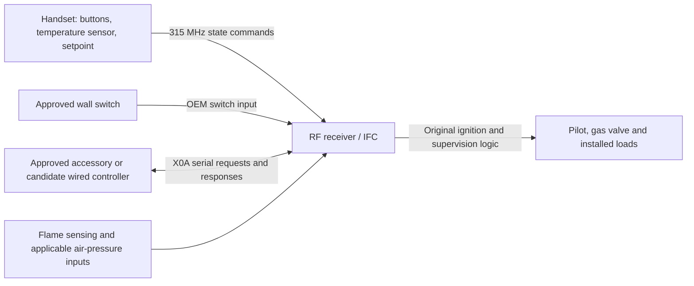

# System operation

[Research overview](README.md)

## Component responsibilities

The diagram combines documented system roles with the community-reported X0A exchange. The candidate controller is not implemented. The IFC contains operational and safety state; a full-state RF command does not make the appliance stateless. [S01, pp. 2-8](sources.md#s01); [S02, appendix](sources.md#s02); [S14](sources.md#s14)

## Ordinary controls

| Control | Documented behavior | Interpretation for integration |
|---|---|---|
| Main power | Starts or stops the main burner request | A request is not proof of ignition or extinction |
| Flame | Six modulation levels plus off | Level zero and main power off are distinct encoded states |
| Thermostat ON | Handset regulates around its temperature setting | Setpoint behavior must not be inferred from a single RF mode bit |
| SMART | Handset varies flame with temperature difference | Manual flame adjustment is disabled in this mode in the transmitter manual |
| Comfort fan | Off and six speed selections, if equipped | Start/stop delays can make a received command appear ineffective |
| Light | Off and six dimmer levels, if equipped | A label reading AUX may refer to a dimmable light on some handsets |
| AUX relay | Separate on/off output, if equipped | Distinct from the multi-level light field |
| Split flow | Enables/disables a secondary burner, if equipped | The community name `front` does not identify the physical burner on every appliance |
| IPI/CPI | Intermittent or continuous-pilot request, subject to local enable | Main burner off can leave the pilot lit |
| Key lock | Locks handset buttons | Does not establish authentication or disable other control paths |

Sources: [S01, pp. 14-20](sources.md#s01); [S04, pp. 5-9](sources.md#s04); [S12, controlled-capture notes](sources.md#s12).

## Pairing and synchronization

For the IFC described in the 2018 manual, SW1 opens a roughly ten-second learning interval, indicated by three beeps and an amber LED. An ON message from the handset completes association, indicated by four beeps. This is documented receiver learning of the transmitter code; it does not specify a cryptographic exchange or establish that arbitrary generated identities are accepted. Exact appliance instructions govern pairing. No pairing was performed. [S02, p. 8](sources.md#s02)

Ordinary accepted remote commands produce a beep in the manufacturer description. An audible indication is not an RF acknowledgment packet, and neither is proof of a flame state. [S01, pp. 14-18](sources.md#s01)

For the wired configuration studied by Bonaparte, active RF control takes precedence over UART control. Serial ownership requests may be denied; state-register responses can then be stale or invalid. Reported wired control becomes available again after the fireplace is turned off through the handset. The actual target's behavior remains to be checked. Handset precedence is retained as normal operation. [S14, Limitations](sources.md#s14); [S15, README](sources.md#s15)

## Startup, shutdown, and fault boundaries

In IPI operation, the IFC establishes and proves the pilot before admitting gas to the main burner. A normal off request removes both flame requests. CPI maintains the pilot when the main burner is off, subject to the installed configuration. Flame supervision, ignition attempts, purge intervals, and lockout belong to the IFC. A failed request must not trigger automatic lockout resets or repeated ignition requests from an integration. [S02, pp. 10-12](sources.md#s02)

The following values belong specifically to **SIT 9.957.201 revision 01, FFRT 10, dated 2018-10-01**. They are reference values, not tunable third-party settings:

| Parameter | Published value |
|---|---|
| Flame-failure response | 10 seconds |
| Safety time / ignition trials | 60 seconds / 2 trials |
| Inter-ignition and recycle time | 30 seconds each |
| ATMO / FAN prepurge | 2 / 15 seconds |
| ATMO / FAN postpurge | 2 / 120 seconds |
| Comfort-fan start / stop delay | 5 / 12 minutes |
| Pilot on Demand | 7 days, only on equipped versions |

[S02, p. 4, visually checked technical-data table](sources.md#s02). The 2016 system catalogue separately describes an optional 5-second FFRT variant; these values must not be merged. [S01, p. 2](sources.md#s01)

The 2018 manual describes a periodic safety shutdown/restart within 24 hours of continued pilot operation, followed by re-execution of the last command. It also describes a separate seven-day Pilot on Demand function. Neither establishes an RF lost-link watchdog. **No general timeout guaranteeing shutdown after loss of the handset was established in the reviewed sources.** [S02, pp. 2, 10 and 12](sources.md#s02)

Lockout deenergizes the pilot and main valve outputs and ignores ignition requests until the prescribed service/reset process is satisfied. This guide intentionally provides no reset sequence or means to defeat that condition. [S02, p. 11](sources.md#s02)

## Power and diagnostics

The handheld uses three AAA cells. The documented U.S. IFC uses 120 V, 60 Hz supply and a 6 V backup battery source. Fans and lighting are unavailable on battery backup; combustion-fan configurations have additional restrictions. [S01, pp. 2 and 5](sources.md#s01); [S02, pp. 2 and 4](sources.md#s02)

The handset displays its own low-battery icon. The IFC manual describes a double beep on a received ON/OFF command when receiver batteries are low, followed by refusal of further commands. Power restoration or battery replacement may resume an ignition request indicated by existing selectors. Restoring power is not an inherently neutral experiment. [S01, p. 20](sources.md#s01); [S02, pp. 8 and 13](sources.md#s02)

The IFC LED diagnostics distinguish lockout (three flashes), parasitic flame detection (two), and low battery (one); no diagnostic flash is the normal entry in the table when supply is adequate. A dark LED alone cannot distinguish normal operation from loss of power. [S02, p. 12, diagnostic table](sources.md#s02)

No verified RF telemetry for actual flame, valve movement, fault details, or battery voltage was found. The wired state registers described below report control state under specified ownership conditions, not independently measured combustion status. [Wired protocol limitations](wired-protocol.md#state-and-ownership-limitations)
