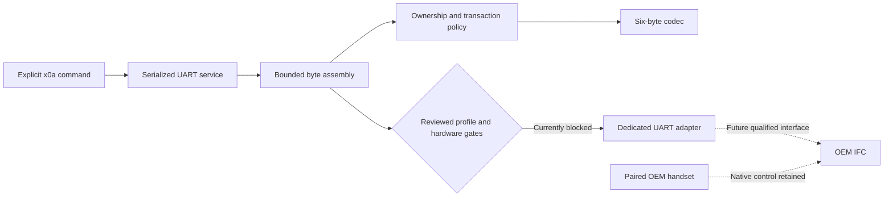

# Wired X0A software

The X0A backend implements a portable codec, transaction controller, byte-framing session, dedicated ESP-IDF UART adapter, configuration validation, and explicit console commands. **Production activation is blocked.** The default configuration opens no UART, configures no X0A GPIO, starts no X0A worker, and emits no traffic, including GETs and ownership requests. No qualified hardware profile exists.

The original ESP32-S3 target, IR transport and storage format, partitions, and Matter light/fan endpoints are retained. No Matter fireplace endpoint or RF controller is added. Physical handset priority, electrical operation, and appliance compatibility remain unverified; the [qualification record](hardware-qualification.md) lists the required evidence.

## Implementation boundaries



| Owner | Responsibility |
|---|---|
| [Protocol codec](../../firmware/components/proflame2_core/protocol.cpp) | Explicit six-byte serialization, XOR, type/register/payload-shape validation |
| [Transaction controller](../../firmware/components/proflame2_core/controller.cpp) | One outstanding operation, ownership checks, field masks, freshness and outcome classification |
| [Session](../../firmware/components/proflame2_core/session.cpp) | Partial frames, bounded transport calls, quiet intervals, sticky quiescence, local operation IDs |
| [UART service](../../firmware/main/proflame2_service.cpp) | Dedicated UART, TX inhibit, FreeRTOS serialization, terminal reporting and atomic reset preparation |
| [Configuration generator](../../tools/proflame2_config.py) | Strict schema, IR-ID conflict detection, reviewed-profile matching and generated constants |

The [wire protocol](wired-protocol.md) is independently reported reverse-engineering evidence, not a public SIT-supported API. Source-reported settings are 9600 baud, 8N1; the exact target must confirm them. The implementation does not execute or import archived community controllers. [S14](sources.md#s14), [S15](sources.md#s15)

## Configuration and activation

[config/proflame2.json](../../config/proflame2.json) is separate from schema-1 IR profiles. It contains `enabled`, `device_id`, appliance/IFC/handset/controller-board/interface identity, a qualification-record reference, `qualified_for_control`, an ordinary-field allowlist, and timing bounds. Unknown identities and timings remain null; the allowlist is empty.

Validation rejects missing, duplicate or unknown keys, incorrect types, unsupported fields, malformed timing bounds, and an enabled IR profile with the same device ID. Physical equivalence under different IDs still requires the G0 inventory. Pilot, thermostat/SMART, lockout resets and arbitrary registers are not configurable controls.

Activation requires an exact match in the generator's reviewed-profile registry. **That registry is empty.** A Boolean or newly written record cannot qualify hardware. Adding a future entry requires actual qualification evidence, source review, and the corresponding reviewed board/interface contract. Synthetic test settings cannot be selected by the production generator.

The independent board interlock is also false. UART number, TX, RX, TX-inhibit GPIO and inhibit polarity are all `-1` in [board_config.hpp](../../firmware/main/board_config.hpp). No existing connector or GPIO is repurposed. The adapter rejects occupied IR/expansion/USB/console, strapping and memory pins and a console UART conflict. Pin eligibility checks do not substitute for a complete board audit.

The five timing fields are `response_timeout_ms`, `inter_request_ms`, `resync_quiet_ms`, `snapshot_max_age_ms` and `inter_byte_ms`. The added inter-byte bound limits a partially received frame. Structural validation requires positive bounded integers, inter-byte time no greater than response timeout, quiet time at least response timeout plus inter-byte time, and snapshot age greater than the request gap. These are software consistency rules, not measured timing qualifications. All production values remain unknown.

```bash
python3 tools/proflame2_config.py config/proflame2.json \
  --ir-profile config/devices.json --header build/generated_proflame2_config.hpp
```

`PROFLAME2_CONFIG` selects a configuration at CMake time; its default is the checked-in disabled file. Both configuration files and generators are configure dependencies. A qualified enabled target build cannot currently be produced without adding missing qualification evidence. No synthetic enabled firmware image is supplied.

## Console interface

| Command | Meaning |
|---|---|
| `x0a status` | Cached diagnostics only; no UART traffic |
| `x0a refresh` | Explicit read-only transaction/recovery; GETs only; disabled in the supplied build |
| `x0a set power on` / `off` | Qualified ordinary power-field request |
| `x0a set flame 0` … `6` | Qualified flame-level field request |
| `x0a set fan 0` … `6` | Qualified fan-level field request |
| `x0a set light 0` … `6` | Qualified light-level field request |
| `x0a set aux on` / `off` | Qualified auxiliary-field request |
| `x0a set split on` / `off` | Qualified split-flow field request (`split_flow` in configuration) |

Set commands describe the implemented grammar; they remain rejected in the supplied build. Field availability must match the particular IFC and installed outputs. Unsupported modes, including thermostat-active state, block changes. Pilot state is preserved rather than exposed as a writable control. Existing `call` and `send` commands retain their IR meanings and do not dispatch X0A.

An accepted operation prints `X0A accepted local_id=…; result pending`. Acceptance is not transmission or appliance success. A separate `X0A result local_id=… outcome=…` record reports completion. IDs are local bookkeeping; no such identifier exists in the observed wire format. Rejected requests print their reason and are never queued.

Status reports configured/active state, hardware qualification, busy state, observed ownership, readback timestamp/age, validity, recovery requirement and last outcome. Timestamp zero means no accepted state snapshot. Invalid or expired register values are displayed as unknown. `NotGranted` is serial ownership evidence; it does not identify active handset use. Register readback never establishes flame presence, extinguishment, or guaranteed shutdown.

## Transaction policy

1. Accept one deliberate request, with no backlog. Reject another request while busy. After protocol uncertainty, require explicit read-only recovery before another change.
2. Discard buffered bytes and wait for a qualified quiet interval. Any intervening malformed, unexpected or partial frame abandons the operation; the parser does not search for a sliding checksum match.
3. For a change, issue at most one ownership SET to register `16`. Confirm ownership with GET `16`, read `17` and `18`, and recheck ownership. Refresh omits the ownership SET entirely.
4. Reject stale or unsupported baselines. Patch only the requested field in one state register, preserving every other bit. Matching values produce `NoChange` without a state write.
5. Check the write response, ownership, both state registers and final ownership. Only a complete matching exchange produces `ReadbackMatched`.
6. Denial/loss before writing stops the request. Any response/readback uncertainty after a state write produces `Indeterminate`. No retry, rollback, speculative OFF, or resumed earlier request follows.

| Outcome | Interpretation |
|---|---|
| `RefreshComplete` | A bounded read-only exchange produced a valid timestamped baseline |
| `ReadbackMatched` | Ownership-checked register readback matched the requested field and preserved fields |
| `NoChange` | The freshly read field already matched; no state write was issued |
| `Disabled`, `Busy`, `InvalidRequest`, `Unsupported` | Request could not proceed |
| `ExternalControl` | UART ownership was not granted; remaining work was discarded |
| `Timeout`, `ProtocolError` | Pre-write exchange failed; readback is invalid and recovery is required |
| `Indeterminate` | A state write may have taken effect; its result cannot be established |
| `RecoveryRequired` | A change was rejected pending explicit read-only resynchronization |

Framing/checksum/response-type/register failures and partial-frame expiry invalidate readback. A failed or partial physical TX closes the session and holds inhibition until restart, because an uncertain hardware FIFO must not be released by another request. Ordinary receive uncertainty allows an explicit refresh after buffer discard and a new quiet interval. Ownership must be confirmed before accepting a recovered state baseline. A new successful observation does not retroactively prove the outcome of an earlier uncertain write.

No protocol transaction ID has been established. Quiet intervals and type/register/payload checks reduce ambiguity only within qualified latency bounds; an arbitrarily delayed valid response can remain indistinguishable. Likewise, software cannot eliminate the ownership-check/write race or observe handset intervention instantaneously. G2/G3 must establish bounds and priority on the exact IFC. Any priority violation blocks activation.

## Startup, reset and failures

The adapter explicitly enables the pinned SDK's framing-error interrupt; the default UART mask omits it. Initialization failure leaves TX inhibited and removes any installed driver. Frame, parity, FIFO-overflow and buffer-full events invalidate an exchange. Host adapter tests exercise setup, failure cleanup and event handling; they do not establish physical UART error detection.

The disabled service creates no UART driver, worker, queue or GPIO configuration. Optional initialization failure is logged without disabling otherwise working IR/Matter functions. No desired X0A state is persisted, and startup, configuration loading, commissioning and reconnect paths issue no X0A operation.

Before a Matter reset is scheduled, the service atomically checks that no X0A operation is active and quiesces it. A busy operation rejects reset. Quiescence is sticky, including when reset scheduling fails; a fresh process is required for initialization. Quiescence does not transmit OFF. Runtime inhibit setup cannot prevent boot/reset/unpowered leakage by itself: an independently safe interface circuit and power-sequencing tests are mandatory.

The generic Python console client still sends exactly one explicit command. A timeout or partial write does not retry `x0a set`; missing terminal output must not be interpreted as definite rejection. No serial client or appliance connection was used for this implementation.

## Verification and remaining work

Run `bash tools/test-host.sh` for configuration, codec, controller, fake-UART, default/forged-activation boundary, console, serial-client and existing IR/Matter tests. Synthetic clocks and transport replies exercise software only. The real ESP-IDF service is also compiled in the ESP32-S3 target build using the pinned SDK.

The [validation report](../validation.md) records completed runs separately from physical work. [G0–G5](hardware-qualification.md) remain pending: exact identities and OEM procedure, interface/power/isolation design, measured framing/timings, handset arbitration, failure behavior and coexistence. No hardware-enabled compatibility or safety claim follows from the software tests or target compilation.
